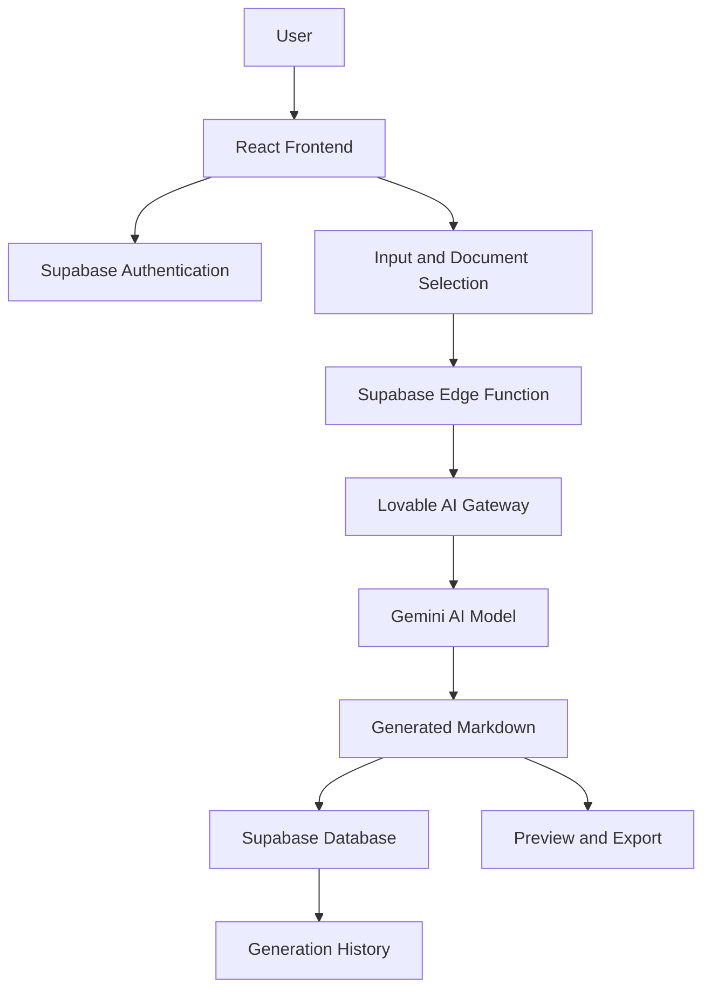

# 📄 AutoDoc AI — Code to Clarity

> Turn ideas, files and information into structured documents with AI.

AutoDoc AI is an AI-powered document generation platform developed as a startup concept for simplifying the creation of technical and professional documents.

The project explores how artificial intelligence can help users generate structured documentation from their input, uploaded files and project references.

<p align="center">
  <a href="https://autodoc-ai.lovable.app">
    
  </a>
  
  
</p>

<p align="center">
  <a href="https://github.com/Muneeb-PT/AutoDoc-AI">GitHub Repository</a>
  ·
  <a href="https://autodoc-ai.lovable.app">Live Application</a>
  ·
  <a href="https://lovable.dev/projects/53c0d838-3711-4647-99d6-cc0f6677f500">Lovable Project</a>
</p>

---

## 💡 The Startup Idea

Creating documentation is an important part of software development, business operations and professional communication. However, writing well-structured documents can be repetitive and time-consuming, particularly for beginners.

**AutoDoc AI aims to make document creation faster and more accessible through artificial intelligence.**

The broader idea is to build a platform that can understand user-provided information and, eventually, software project structures to generate useful and organized documentation.

## 🎯 Problem & Proposed Solution

### The Problem

- Creating project documentation takes time.
- Beginners may struggle to organize technical information.
- Different documents require different structures and formats.
- Keeping documentation consistent can be challenging.

### The Proposed Solution

AutoDoc AI provides a web interface where users can submit text, upload files or provide a repository URL and request an AI-generated document.

The goal is to simplify the document creation process through an accessible interface and customizable generation options.

## ✨ Current Prototype Features

| Feature | Description |
|---|---|
| AI Document Generation | Generate structured documents using an AI model. |
| Multiple Document Types | README, Resume, Report, Proposal and API Documentation. |
| Multiple Input Methods | Enter text, upload files or provide a repository URL. |
| Language Selection | Select a language for generated content. |
| Custom Instructions | Add key points and additional context. |
| Document Preview | Review generated content in the application. |
| Markdown Export | Download generated documents as Markdown files. |
| PDF Export | Use the browser's print interface to save documents as PDF. |
| HTML Templates | Export using available document templates. |
| User Authentication | Sign up and sign in through Supabase authentication. |
| Generation History | Access previous document-generation jobs. |
| Admin Dashboard | View user and document-generation information. |

**Important implementation note:** Repository URL input is supported in the current prototype, but it does not yet clone or inspect the repository's actual source code. Genuine source-code analysis is a planned future capability.

## ⚙️ How It Works

The current prototype follows this workflow:

1. **Provide Input** — Enter text, upload a file or provide a repository URL.
2. **Select Document Type** — Choose the document you want to generate.
3. **Customize** — Select a language and add additional instructions.
4. **AI Processing** — The Supabase Edge Function sends the request to the Lovable AI Gateway.
5. **Generate** — The AI model produces structured Markdown content.
6. **Preview & Export** — Review the generated document and use the available export options.

## 🧠 Future Product Vision

The long-term vision is to develop AutoDoc AI into a more advanced documentation platform.

Potential future capabilities include:

- Actual GitHub repository ingestion and source-code analysis.
- Abstract Syntax Tree (AST) parsing.
- Dependency and architecture graph generation.
- Context-aware codebase question answering.
- Retrieval-Augmented Generation (RAG).
- Automated API documentation.
- Documentation version comparison.
- GitHub integration and repository synchronization.
- Automated documentation updates through CI/CD.
- Hosted documentation websites.

These are proposed capabilities, not claims about the current implementation.

## 🛠️ Technology Stack

| Technology | Purpose |
|---|---|
| React | Frontend application |
| TypeScript | Application development |
| Vite | Development server and build tooling |
| Tailwind CSS | Styling and responsive layouts |
| shadcn/ui | UI components |
| Radix UI | Accessible interface primitives |
| Framer Motion | UI animations |
| Lucide React | Icons |
| Supabase | Authentication and database services |
| Supabase Edge Functions | Backend document-generation workflow |
| Lovable AI Gateway | AI model access |
| Gemini 3 Flash Preview | Document generation model |
| GitHub | Source-code hosting |
| Lovable | AI-assisted application development |

## 🏗️ Application Architecture

The current application uses a React frontend connected to Supabase services and an AI gateway.



## 📂 Project Structure

```text
AutoDoc-AI/
├── public/
├── src/
│   ├── components/
│   ├── hooks/
│   ├── integrations/
│   │   └── supabase/
│   ├── pages/
│   ├── App.tsx
│   └── main.tsx
├── supabase/
│   ├── functions/
│   │   └── analyze-repo/
│   │       └── index.ts
│   └── config.toml
├── index.html
├── package.json
├── vite.config.ts
└── README.md
```

## 🚀 Run Locally

### Prerequisites

- Node.js
- npm
- A configured Supabase project

### 1. Clone the repository

```bash
git clone https://github.com/Muneeb-PT/AutoDoc-AI.git
```

### 2. Navigate to the project directory

```bash
cd AutoDoc-AI
```

### 3. Install dependencies

```bash
npm install
```

### 4. Configure environment variables

Create a `.env` file in the project root:

```env
VITE_SUPABASE_URL=your_supabase_project_url
VITE_SUPABASE_PUBLISHABLE_KEY=your_supabase_publishable_key
```

The Supabase Edge Function also requires the `LOVABLE_API_KEY` secret to access the AI Gateway.

Keep private API keys and service-role credentials out of your repository.

### 5. Start the development server

```bash
npm run dev
```

Open the local URL displayed in your terminal.

### 6. Build for production

```bash
npm run build
```

## 🎓 Academic Background

| Detail | Information |
|---|---|
| Project | AutoDoc AI |
| Project Type | Mini Project / Startup Idea |
| Semester | S1 |
| Programme | B.Tech Computer Science and Engineering |
| Subject | Engineering Entrepreneurship and IPR |
| Institution | KMEA Engineering College |
| University | APJ Abdul Kalam Technological University (KTU) |

**Academic Objective:** Identify a real-world problem, develop a startup concept, explore its potential value proposition and demonstrate the idea through a software prototype.

## 🤖 Development Approach & AI Assistance

This project was developed using **Lovable AI** as the primary AI-assisted development platform.

At the time, my programming knowledge was limited. Since the academic subject focused mainly on entrepreneurship, the startup idea and its potential application, I used Lovable to accelerate the creation of a working prototype.

This experience introduced me to:

- Turning a startup idea into a digital product concept.
- Exploring frontend and backend application architecture.
- Integrating AI into a web application.
- Understanding authentication and database-backed workflows.
- Using AI-assisted tools for rapid prototyping.

This is an AI-assisted academic prototype, not a claim of independently developing a complete production-ready commercial platform.

## 🔭 Future Scope

Possible future development directions include:

- Real GitHub repository cloning and source-code parsing.
- Multi-language code analysis.
- AI-powered architecture discovery.
- Documentation generated from actual source code.
- More advanced templates and customization.
- Team collaboration and workspace management.
- Subscription and payment integration.
- Production deployment and scalability improvements.

## 📌 Project Status

**Academic Startup Prototype — Developed**

The current application demonstrates the concept of AI-assisted document generation. Advanced code-intelligence and commercial capabilities remain part of the future scope.

## 👨‍💻 Creator

**Mohammed Muneeb PT**

B.Tech Computer Science and Engineering  
KMEA Engineering College, Kerala, India

- GitHub: [@Muneeb-PT](https://github.com/Muneeb-PT)
- LinkedIn: [Mohammed Muneeb PT](https://linkedin.com/in/mohammed-muneeb-pt)

---

<p align="center">
  <strong>AutoDoc AI — Code to Clarity.</strong>
  <br>
  Turning documentation into a simpler process.
</p>
