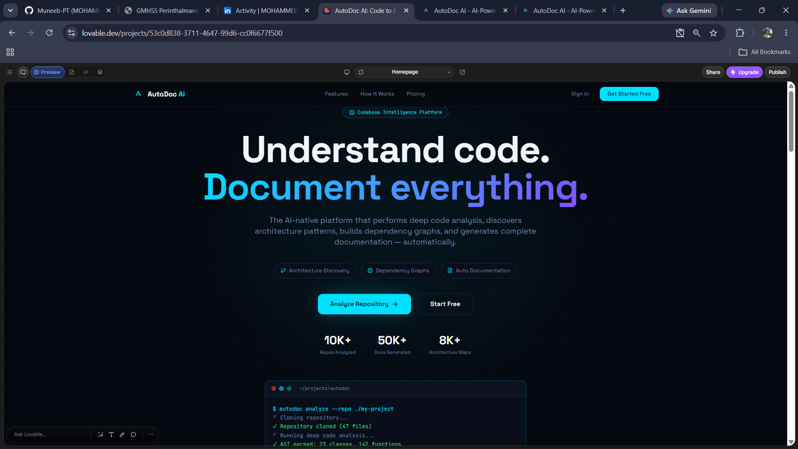
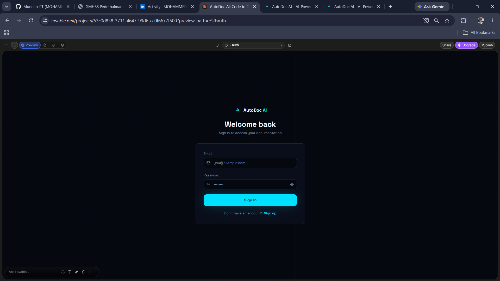
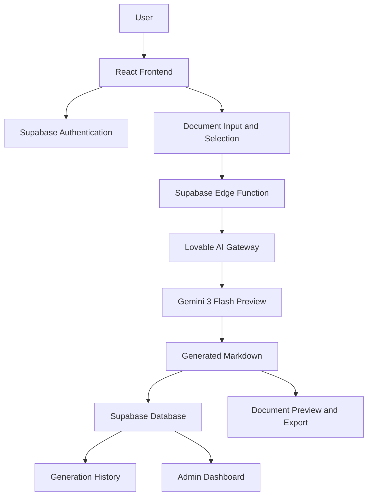

# 📄 AutoDoc AI — Code to Clarity

> **Turn ideas, files and information into structured documents with AI.**

AutoDoc AI is an AI-powered document generation platform developed around a startup idea: simplifying the creation of technical and professional documents through artificial intelligence.

The project explores how AI can reduce the time and effort involved in documentation by transforming user-provided information, files and project references into structured documents.

<p align="center">
  <a href="https://autodoc-ai.lovable.app">
    
  </a>
  
  
</p>

<p align="center">
  <a href="https://github.com/Muneeb-PT/AutoDoc-AI">GitHub Repository</a>
  ·
  <a href="https://autodoc-ai.lovable.app">Live Application</a>
  ·
  <a href="https://lovable.dev/projects/53c0d838-3711-4647-99d6-cc0f6677f500">Lovable Project</a>
</p>

---

## 🖥️ Application Screenshots

### Home Page

<p align="center">
  
</p>

### Login & Authentication

<p align="center">
  
</p>

---

## 💡 The Startup Idea

Documentation is an essential part of software development, business operations and professional communication. However, creating well-structured documentation can be repetitive, time-consuming and difficult for individuals who are not experienced in technical writing.

**AutoDoc AI aims to make document creation faster and more accessible through artificial intelligence.**

The long-term idea is to develop a platform that understands project structures and user-provided information, then generates useful, organized and customizable documentation.

The concept is intended for developers, students, startups, software teams and professionals.

## 🎯 Problem & Proposed Solution

### The Problem

- Writing project documentation takes time.
- Maintaining consistent documentation across projects can be difficult.
- Beginners may struggle to structure technical documents.
- Different professional documents require different formats and writing styles.

### The Proposed Solution

AutoDoc AI provides an interface where users can supply information through text, uploaded files or repository references and request AI-generated documents.

The platform aims to make documentation creation more accessible, customizable and efficient.

## ✨ Implemented Features

| Feature | Description |
|---|---|
| AI Document Generation | Generate structured documents using an AI model. |
| Multiple Document Types | README, Resume, Report, Proposal and API Documentation. |
| Multiple Input Methods | Enter text, upload files or provide a repository URL. |
| Multiple File Upload | Provide project files for document generation. |
| Voice Input | Enter text using browser-supported speech recognition. |
| Language Selection | Generate content in a selected language. |
| Custom Instructions | Add key points and additional context. |
| Document Preview | View generated content in the application. |
| Markdown Export | Download generated documents as Markdown files. |
| PDF Export | Open the browser's print interface to save content as PDF. |
| HTML Templates | Export using available visual templates. |
| User Authentication | Sign up and sign in using Supabase authentication. |
| Generation History | Access previously generated documents. |
| Admin Dashboard | View registered users and document-generation jobs. |
| Role Management | Distinguish administrator and regular user roles. |

### Export Options

The current prototype provides:

- **Markdown:** Download generated Markdown content.
- **PDF:** Open a printable document in a new browser window.
- **HTML:** Export using available templates.
- **DOCX option:** Currently implemented as HTML content downloaded with a `.docx` extension; it is not a native DOCX document generator.

The HTML template selector includes Minimal Clean, Startup Bold and Open Source templates as free options. Enterprise Pro, API Reference and Developer Onboarding are marked as premium.

### Important Implementation Note

Repository URL input is supported, but the current backend does not clone, download or parse the repository's source code. It passes the supplied repository URL and extracted repository name to the AI model as context.

Actual source-code analysis is part of the future product vision, not a currently implemented capability.

## ⚙️ How It Works

The current prototype follows this workflow:

1. **Provide Input** — Enter a topic, upload files or provide a repository URL.
2. **Choose Document Type** — Select README, Resume, Report, Proposal or API Documentation.
3. **Customize** — Select a language and provide additional instructions.
4. **AI Processing** — The Supabase Edge Function prepares the request and sends it to the Lovable AI Gateway.
5. **Document Generation** — Gemini generates structured Markdown content.
6. **Save & Preview** — The generated result is stored in Supabase and displayed in the application.
7. **Export** — Download the generated document using an available export option.

## 🧠 Product Vision

The broader startup vision goes beyond basic document generation.

Potential future capabilities include:

- Automated source-code analysis using Abstract Syntax Trees (AST).
- Dependency and architecture graph generation.
- Context-aware codebase question answering.
- Retrieval-Augmented Generation (RAG).
- Automatic API documentation from actual source code.
- Documentation version comparison.
- GitHub integration and repository synchronization.
- Automated documentation updates through CI/CD.
- Hosted documentation websites.

These represent the proposed product direction and are not all implemented in the current prototype.

## 🛠️ Technology Stack

| Technology | Purpose |
|---|---|
| React | Frontend application |
| TypeScript | Type-safe application development |
| Vite | Development server and build tooling |
| Tailwind CSS | Styling and responsive layouts |
| shadcn/ui | UI components |
| Radix UI | Accessible interface primitives |
| Framer Motion | UI animations |
| Lucide React | Icons |
| Supabase | Authentication and database services |
| PostgreSQL | Database |
| Supabase Edge Functions | Backend document-generation workflow |
| Lovable AI Gateway | AI model access |
| Gemini 3 Flash Preview | Document generation model |
| GitHub Actions | Automated build and deployment workflow |
| GitHub | Source-code hosting |
| Lovable | AI-assisted application development |

## 🏗️ Application Architecture

The current application uses a React frontend connected to Supabase services and an external AI gateway.



## 🗄️ Database Overview

The project uses Supabase PostgreSQL with database migrations.

The main database entities include:

| Table | Purpose |
|---|---|
| `analysis_jobs` | Stores document-generation jobs, status, results and errors. |
| `profiles` | Stores registered user profile information. |
| `user_roles` | Stores user and administrator roles. |

Row Level Security (RLS) policies are used to control access to database records.

## 📂 Project Structure

```text
AutoDoc-AI/
│
├── .github/
│   └── workflows/
│       └── deploy.yml
│
├── assets/
│   ├── home.png
│   └── login.png
│
├── public/
│
├── src/
│   ├── components/
│   ├── hooks/
│   ├── integrations/
│   │   └── supabase/
│   ├── lib/
│   ├── pages/
│   ├── test/
│   ├── App.css
│   ├── App.tsx
│   ├── index.css
│   ├── main.tsx
│   └── vite-env.d.ts
│
├── supabase/
│   ├── functions/
│   │   └── analyze-repo/
│   │       └── index.ts
│   ├── migrations/
│   └── config.toml
│
├── index.html
├── package.json
├── package-lock.json
├── bun.lock
├── vite.config.ts
├── components.json
├── eslint.config.js
└── README.md
```

## 🚀 Run Locally

### Prerequisites

- Node.js 22 or a compatible supported version.
- npm.
- A configured Supabase project.
- Required Supabase environment variables and Edge Function secrets.

### 1. Clone the repository

```bash
git clone https://github.com/Muneeb-PT/AutoDoc-AI.git
```

### 2. Navigate to the project

```bash
cd AutoDoc-AI
```

### 3. Install dependencies

```bash
npm install
```

### 4. Configure environment variables

Create a `.env` file in the project root:

```env
VITE_SUPABASE_URL=your_supabase_project_url
VITE_SUPABASE_PUBLISHABLE_KEY=your_supabase_publishable_key
```

The Supabase Edge Function also requires the appropriate Supabase configuration and a `LOVABLE_API_KEY` secret.

Never commit private API keys, service-role keys or other secrets to GitHub.

### 5. Start the development server

```bash
npm run dev
```

Open the local URL displayed in your terminal.

### 6. Build for production

```bash
npm run build
```

### 7. Run tests

```bash
npm test
```

### 8. Run lint checks

```bash
npm run lint
```

## 🚀 Deployment

The repository includes a GitHub Actions workflow at:

```text
.github/workflows/deploy.yml
```

The workflow is configured to:

1. Run when changes are pushed to `main` or manually triggered.
2. Set up Node.js 22.
3. Install project dependencies.
4. Build the Vite application.
5. Deploy the generated `dist` directory to GitHub Pages.

The workflow requires the relevant GitHub Pages permissions and Supabase repository variables.

**Note:** The current dependency lockfile must be synchronized with `package.json` for the workflow's `npm ci` installation step to succeed.

## 🎓 Academic Background

| Detail | Information |
|---|---|
| Project | AutoDoc AI |
| Project Type | Mini Project / Startup Idea |
| Semester | S1 |
| Programme | B.Tech Computer Science and Engineering |
| Subject | Engineering Entrepreneurship and IPR |
| Institution | KMEA Engineering College |
| University | APJ Abdul Kalam Technological University (KTU) |

**Academic Focus:** Identifying a real-world problem, developing a startup concept, exploring its potential value proposition and presenting the idea through a software prototype.

## 🤖 Development Approach & AI Assistance

This project was developed using **Lovable AI** as the primary AI-assisted development platform.

At the time of this project, my programming knowledge was limited. Since the academic focus was primarily on the startup idea, its potential application and entrepreneurial aspects, I used Lovable to accelerate the development of a working prototype.

The development process helped me explore:

- Converting a startup idea into a digital product concept.
- Understanding frontend and backend application architecture.
- Exploring AI integration in software applications.
- Understanding authentication and database-backed workflows.
- Evaluating how AI-assisted development can support rapid prototyping.

The implementation should be understood as an AI-assisted academic prototype rather than a fully independently programmed or production-ready commercial platform.

## 🔭 Future Scope

The long-term goal is to evolve AutoDoc AI into a more capable documentation platform.

Possible development directions include:

- Real GitHub repository ingestion and source-code parsing.
- Multi-language code analysis.
- AI-powered architecture discovery.
- More accurate documentation grounded in actual source code.
- Advanced document templates and customization.
- Team collaboration and workspace management.
- Subscription and payment integration.
- Enterprise deployment options.

## 📌 Project Status

**Academic Startup Prototype — Developed**

The current application demonstrates the core concept of AI-assisted document generation. Advanced code-intelligence capabilities and commercial features remain part of the proposed future scope.

## 👨‍💻 Creator

**Mohammed Muneeb PT**

B.Tech Computer Science and Engineering  
KMEA Engineering College, Kerala, India

- **GitHub:** [@Muneeb-PT](https://github.com/Muneeb-PT)
- **LinkedIn:** [Mohammed Muneeb PT](https://linkedin.com/in/mohammed-muneeb-pt)

---

<p align="center">
  <strong>AutoDoc AI — Code to Clarity.</strong>
  <br>
  Turning documentation into a simpler process.
</p>
